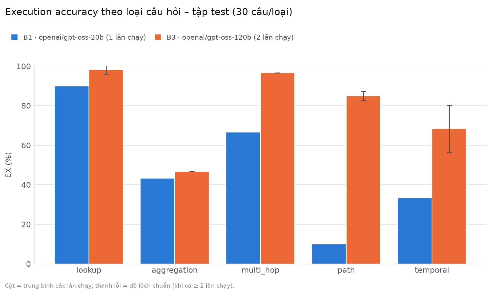
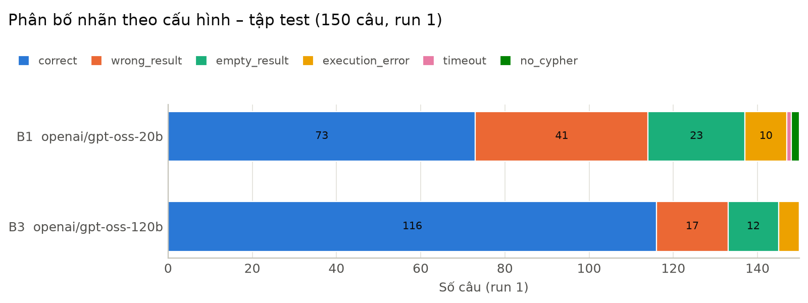

# Kết quả giữa kỳ – baseline Text-to-Cypher (tập test)

Tạo tự động bằng `python eval/summarize.py --split test` từ các file trong `results/runs/test/`. Mọi con số là kết quả chạy thật; cấu hình/lần chạy chưa chạy xong không có trong bảng (xem mục g).

## a. Thông tin chạy

**Thay đổi so với kế hoạch:**

- Groq đã gỡ llama-3.1-8b-instant và llama-3.3-70b-versatile khỏi gói free/developer từ 16/08/2026 (thông báo ngày 17/06/2026, https://console.groq.com/docs/deprecations); ngày 20/10/2026 gọi API hai model này trả lỗi 404 model_not_found và danh sách model của tài khoản không còn chúng. Bảo đồng ý đổi model với yêu cầu có một model yếu và một model mạnh; chốt: B1 = openai/gpt-oss-20b (model yếu, Groq khuyến nghị thay Llama 3.1 8B), B3 = openai/gpt-oss-120b (model mạnh, cùng họ gpt-oss), bỏ B3a (Llama 3.3 70B) vì không còn model Production nào khác để thay.
- Câu trả lời văn bản (cờ --answers) sinh bằng openai/gpt-oss-20b thay cho llama-3.1-8b-instant, và chỉ sinh cho các câu correct (đủ để làm ví dụ demo, đỡ tốn hạn mức).
- gpt-oss là model có bước suy luận (reasoning) trước khi trả lời: dùng mức suy luận mặc định của Groq, temperature 0, giữ nguyên PROMPT zero-shot như kế hoạch.

| Cấu hình | Model (ID trên Groq) | Lần | Sinh Cypher (giờ gọi LLM) | Chấm điểm | Số câu |
|---|---|---|---|---|---|
| B1 | `openai/gpt-oss-20b` | 1 | 2026-10-20 16:25 → 2026-10-20 20:14 | 2026-10-20 20:14 | 150 |
| B3 | `openai/gpt-oss-120b` | 1 | 2026-10-20 16:25 → 2026-10-20 16:37 | 2026-10-20 16:37 | 150 |
| B3 | `openai/gpt-oss-120b` | 2 | 2026-10-20 16:37 → 2026-10-20 17:04 | 2026-10-20 17:04 | 150 |

- Temperature: 0; timeout mỗi truy vấn: 30 s; chạy ở chế độ chỉ đọc; đọc tối đa 1000 dòng kết quả (gold ≤ 20 dòng nên không ảnh hưởng chấm).
- Số lần chạy mỗi cấu hình: B1 = 1, B3 = 2.
- Neo4j: 5.26.31 community. Thư viện: python 3.12.3, neo4j 6.4.1, groq 1.7.0, python-dotenv 1.2.4.
- SHA-256 của `test.json` (chuẩn hóa như `split_info.json`): `d3377f4e1afd0dea4a6fc094abbe8f3836854efb4de8d868a0aa2d04416dd058` – **khớp** `split_info.json`.
- Schema đưa vào prompt: giống nhau ở mọi lượt (SHA-256 `91fa02464f603bec…`).

Prompt zero-shot của B1/B3 (giữ nguyên `PROMPT` trong `eval/pilot_text2cypher.py`; `{schema}` là schema trích tự động bằng `build_schema`):

```
You are an expert Neo4j developer. Write one Cypher query that answers the question
using only the graph schema below. Return only the Cypher query, with no explanation.

Schema:
{schema}

Question: {question}
Cypher:
```

Prompt sinh câu trả lời văn bản (`openai/gpt-oss-20b`, tối đa 20 dòng kết quả):

```
Answer the question in one or two sentences using only these query results.

Question: {question}
Query results:
{rows}
Answer:
```

## b. Hạn mức Groq

Nguồn: requests/ngày và tokens/phút đọc từ header x-ratelimit-* khi gọi API bằng tài khoản của nhóm; requests/phút và tokens/ngày lấy từ bảng ở https://console.groq.com/docs/rate-limits (trang ghi đây là mức cơ bản của gói Developer); tra ngày 2026-10-20.

| Model | Requests/phút | Requests/ngày | Tokens/phút | Tokens/ngày |
|---|---|---|---|---|
| `openai/gpt-oss-20b` | 30 (tài liệu) | 1.000 (header) | 8.000 (header) | 200K (tài liệu) |
| `openai/gpt-oss-120b` | 30 (tài liệu) | 1.000 (header) | 8.000 (header) | 200K (tài liệu) |

- Đo trên 10 câu dev với gpt-oss-120b: trung bình khoảng 980 token/câu (792 token prompt + 186 token output, tính cả phần suy luận), nên một lượt test 150 câu cần khoảng 150K token, gần trọn hạn mức tokens/ngày của một model. Hạn mức tính riêng cho từng model.

## c. Kiểm tra khung chấm bằng oracle

Oracle trả về đúng Cypher gold; khung đúng khi chấm 100% `correct`. Oracle không phải baseline.

| Tập | Đúng | Tỉ lệ | Ngày chạy |
|---|---|---|---|
| dev | 92/92 | 100% | 2026-10-20 13:10 |
| test | 150/150 | 100% | 2026-10-20 13:11 |

## d. Execution accuracy (EX) theo loại câu hỏi

EX = % câu `correct` (30 / 30 / 30 / 30 / 30 câu mỗi loại, 150 câu tổng). Có ≥ 2 lần chạy: trung bình ± độ lệch chuẩn mẫu (n−1); có 1 lần: số của lần đó, ghi "(1 lần)".

| Cấu hình | Model | Số lần chạy | lookup | aggregation | multi_hop | path | temporal | Tổng |
|---|---|---|---|---|---|---|---|---|
| B1 | `openai/gpt-oss-20b` | 1 | 90.0 (1 lần) | 43.3 (1 lần) | 66.7 (1 lần) | 10.0 (1 lần) | 33.3 (1 lần) | 48.7 (1 lần) |
| B3 | `openai/gpt-oss-120b` | 2 | 98.3 ± 2.4 | 46.7 ± 0.0 | 96.7 ± 0.0 | 85.0 ± 2.4 | 68.3 ± 11.8 | 79.0 ± 2.4 |

### Phân bố nhãn (run 1)

| Cấu hình | Model | correct | wrong_result | empty_result | execution_error | timeout | no_cypher | llm_error | Tổng |
|---|---|---|---|---|---|---|---|---|---|
| B1 | `openai/gpt-oss-20b` | 73 | 41 | 23 | 10 | 1 | 2 | 0 | 150 |
| B3 | `openai/gpt-oss-120b` | 116 | 17 | 12 | 5 | 0 | 0 | 0 | 150 |

Biểu đồ: `ex_by_type.png`, `verdicts.png`.





## e. Ví dụ lỗi tiêu biểu (B1 run 1)

Chọn tay từ `errors_B1.md` (toàn bộ 77 câu sai của B1 run 1).

**AG-02-02** (aggregation) – nhãn `empty_result`

- Câu hỏi: In United Kingdom, which city do the largest number of people live in?
- **Nguyên nhân:** Viết tên quốc gia theo cách viết thường `'United Kingdom'`, trong khi dữ liệu lưu `United_Kingdom` (dấu `_` thay khoảng trắng), nên không khớp node nào và kết quả rỗng. Cùng lỗi này làm sai gần hết câu hỏi về tag (vd `"Phil Spector"` thay vì `Phil_Spector`).
- Cypher sinh ra:

```cypher
MATCH (c:Place:City)-[:IS_PART_OF]->(co:Place:Country {name: 'United Kingdom'}), (p:Person)-[:IS_LOCATED_IN]->(c)
RETURN c.name AS city, count(p) AS numPeople
ORDER BY numPeople DESC
LIMIT 1
```

- Cypher gold:

```cypher
MATCH (p:Person)-[:IS_LOCATED_IN]->(c:City)-[:IS_PART_OF]->(:Country {name: 'United_Kingdom'}) RETURN c.name, count(DISTINCT p) AS n ORDER BY n DESC LIMIT 1
```

- Kết quả gold: `[["Bristol"]]`
- Kết quả sinh ra (0 dòng, tối đa 5 dòng đầu): `[]`

**PA-04-01** (path) – nhãn `wrong_result`

- Câu hỏi: How many people can Maria Onopka reach within two friendship steps?
- **Nguyên nhân:** Dùng `-[:KNOWS*1..2]->` có chiều. Mỗi cặp bạn chỉ lưu một cạnh KNOWS theo một chiều, nên đi một chiều chỉ đếm được 10 người thay vì 646. Đây là lỗi chính khiến loại path gần như sai hết.
- Cypher sinh ra:

```cypher
MATCH (m:Person {firstName:'Maria', lastName:'Onopka'})
MATCH (m)-[:KNOWS*1..2]->(p:Person)
WHERE p <> m
RETURN count(DISTINCT p) AS reachableCount
```

- Cypher gold:

```cypher
MATCH (p:Person {firstName: 'Maria', lastName: 'Onopka'})-[:KNOWS*1..2]-(f:Person) WHERE f <> p RETURN count(DISTINCT f)
```

- Kết quả gold: `[[646]]`
- Kết quả sinh ra (1 dòng, tối đa 5 dòng đầu): `[[10]]`

**LK-01-07** (lookup) – nhãn `empty_result`

- Câu hỏi: Which city does Kieu Cong Do live in?
- **Nguyên nhân:** Tách sai họ tên nhiều chữ: "Kieu Cong Do" thành firstName `Kieu`, lastName `Cong Do`, trong khi dữ liệu là firstName `Kieu Cong`, lastName `Do`. Model không thể biết cách tách nếu không tra cứu đồ thị.
- Cypher sinh ra:

```cypher
MATCH (p:Person {firstName: "Kieu", lastName: "Cong Do"})-[:IS_LOCATED_IN]->(c:City:Place)
RETURN c.name AS city
```

- Cypher gold:

```cypher
MATCH (:Person {firstName: 'Kieu Cong', lastName: 'Do'})-[:IS_LOCATED_IN]->(c:City) RETURN c.name
```

- Kết quả gold: `[["Đà_Lạt"]]`
- Kết quả sinh ra (0 dòng, tối đa 5 dòng đầu): `[]`

**TM-03-04** (temporal) – nhãn `empty_result`

- Câu hỏi: Which forum did Anna Kofler join first?
- **Nguyên nhân:** Đảo chiều quan hệ: viết `(Person)-[:HAS_MEMBER]->(Forum)` trong khi schema là `(Forum)-[:HAS_MEMBER]->(Person)`, nên không khớp cạnh nào và kết quả rỗng.
- Cypher sinh ra:

```cypher
MATCH (p:Person {firstName:"Anna", lastName:"Kofler"})-[r:HAS_MEMBER]->(f:Forum)
RETURN f.title
ORDER BY r.joinDate ASC
LIMIT 1
```

- Cypher gold:

```cypher
MATCH (f:Forum)-[m:HAS_MEMBER]->(:Person {firstName: 'Anna', lastName: 'Kofler'}) RETURN f.title ORDER BY m.joinDate LIMIT 1
```

- Kết quả gold: `[["Wall of Rudolf Engel"]]`
- Kết quả sinh ra (0 dòng, tối đa 5 dòng đầu): `[]`

**TM-01-04** (temporal) – nhãn `execution_error`

- Câu hỏi: How many posts did John Chatterjee create in 2010?
- **Nguyên nhân:** Dùng hàm `year()` không có trong Cypher (lỗi cú pháp). Phải lấy thành phần năm của thuộc tính ngày giờ: `post.creationDate.year`.
- Cypher sinh ra:

```cypher
MATCH (post:Message)-[:HAS_CREATOR]->(p:Person {firstName:'John', lastName:'Chatterjee'})
WHERE year(post.creationDate) = 2010
RETURN count(post) AS postsCount
```

- Cypher gold:

```cypher
MATCH (:Person {firstName: 'John', lastName: 'Chatterjee'})<-[:HAS_CREATOR]-(p:Post) WHERE p.creationDate.year = 2010 RETURN count(DISTINCT p)
```

- Kết quả gold: `[[90]]`
- Lỗi: `Neo.ClientError.Statement.SyntaxError: Unknown function 'year' (line 2, column 7 (offset: 96))`

**MH-04-05** (multi_hop) – nhãn `wrong_result`

- Câu hỏi: Which countries are Bjorn Andersson's employers based in?
- **Nguyên nhân:** Trả về nguyên node Country (`RETURN DISTINCT country`) thay vì `country.name`. Node chứa đúng đáp án "Sweden" nhưng `judge` chỉ so giá trị nên chấm `wrong_result` (xem ghi chú về `judge` ở mục g).
- Cypher sinh ra:

```cypher
MATCH (p:Person {firstName:"Bjorn", lastName:"Andersson"})-[:WORK_AT]->(c:Company)-[:IS_LOCATED_IN]->(country:Country)
RETURN DISTINCT country
```

- Cypher gold:

```cypher
MATCH (:Person {firstName: 'Bjorn', lastName: 'Andersson'})-[:WORK_AT]->(:Company)-[:IS_LOCATED_IN]->(k:Country) RETURN DISTINCT k.name
```

- Kết quả gold: `[["Sweden"]]`
- Kết quả sinh ra (1 dòng, tối đa 5 dòng đầu): `[[{"_labels": ["Country", "Place"], "name": "Sweden", "id": 101, "url": "http://dbpedia.org/resource/Sweden"}]]`

**Ghi chú thêm:**

- Về `judge`: 5 câu `wrong_result` của B1 run 1 trả về nguyên node chứa đúng đáp án (LK-02-09, MH-02-01, MH-04-05, TM-03-02, TM-03-05); B3 có 1 câu ở run 1 (TM-03-02) và 0 câu ở run 2. Nếu tính các câu này là đúng thì B1 run 1 đạt 78/150 (52,0%) thay vì 73/150 (48,7%).
- 2 câu `no_cypher` của B1 run 1 (TM-05-06, TM-05-10): gpt-oss-20b suy luận đến hết giới hạn 2.048 token đầu ra mặc định của Groq (finish_reason = length) nên không kịp trả về Cypher. Giữ cấu hình mặc định, không tăng giới hạn.
- 5 câu `execution_error` của B1 run 1 do dùng hàm `year()` không tồn tại trong Cypher (phải dùng thuộc tính `.year` của giá trị ngày giờ).

## f. Ví dụ câu trả lời văn bản (B1 run 1, câu đúng)

**LK-01-01** (lookup)

- Câu hỏi: Which city does Djelaludin Zaland live in?
- Cypher:

```cypher
MATCH (p:Person {firstName: "Djelaludin", lastName: "Zaland"})-[:IS_LOCATED_IN]->(c:City)
RETURN c.name AS city
```

- Kết quả: `[["Herat"]]`
- Câu trả lời: Djelaludin Zaland lives in Herat.

**AG-02-01** (aggregation)

- Câu hỏi: Which city in Afghanistan has the most residents?
- Cypher:

```cypher
MATCH (c:City)-[:IS_PART_OF]->(co:Country {name: 'Afghanistan'})
MATCH (p:Person)-[:IS_LOCATED_IN]->(c)
WITH c, count(DISTINCT p) AS residentCount
RETURN c.name AS city, residentCount
ORDER BY residentCount DESC
LIMIT 1
```

- Kết quả: `[["Herat", 4]]`
- Câu trả lời: Herat has the most residents.

**MH-02-03** (multi_hop)

- Câu hỏi: Among the friends of Narong Boy, which university has the most students?
- Cypher:

```cypher
MATCH (p:Person {firstName:"Narong", lastName:"Boy"})-[:KNOWS]-(friend:Person)-[:STUDY_AT]->(uni:Organisation:University)
WITH uni, count(DISTINCT friend) AS studentCount
ORDER BY studentCount DESC
LIMIT 1
RETURN uni.name AS university, studentCount
```

- Kết quả: `[["Hangzhou_International_School", 5]]`
- Câu trả lời: Hangzhou International School has the most students, with a total of 5.

## g. Những gì chưa làm hoặc chưa chạy

- B1 (`openai/gpt-oss-20b`) run 2: chưa chạy xong (mới sinh Cypher cho 5/150 câu).
- B1 (`openai/gpt-oss-20b`) run 3: chưa chạy.
- B3 (`openai/gpt-oss-120b`) run 3: chưa chạy xong (mới sinh Cypher cho 28/150 câu).
- B2 (`openai/gpt-oss-20b`): chưa chạy lần nào.
- Cần Bảo quyết: `judge` chấm `wrong_result` khi Cypher trả về nguyên node dù node chứa đúng đáp án (xem ghi chú ở mục e). Theo quy tắc mình giữ nguyên `judge`; nếu đổi cách chấm thì chạy lại `run_eval.py` sẽ chấm lại từ cache, không cần gọi LLM.
- B2 (GraphCypherQAChain, P2): chưa làm. B2 dùng chung model gpt-oss-20b với B1 và tốn khoảng 2 lời gọi LLM mỗi câu, trong khi hạn mức 200K token/ngày của model này chỉ đủ cho các lượt B1. Để sau giữa kỳ.
- B3a (llama-3.3-70b-versatile): bỏ vì Groq đã gỡ model này (xem mục a).
- B0 (rule-based) và script run_all.ps1: để sau giữa kỳ theo kế hoạch.

Sửa code sau khi đã chạy test (quy tắc 2): 

- eval/summarize.py: thêm phần "Ghi chú thêm" (lấy từ error_notes trong manual.json) vào mục e. Chỉ đổi cách trình bày, không ảnh hưởng số liệu.
